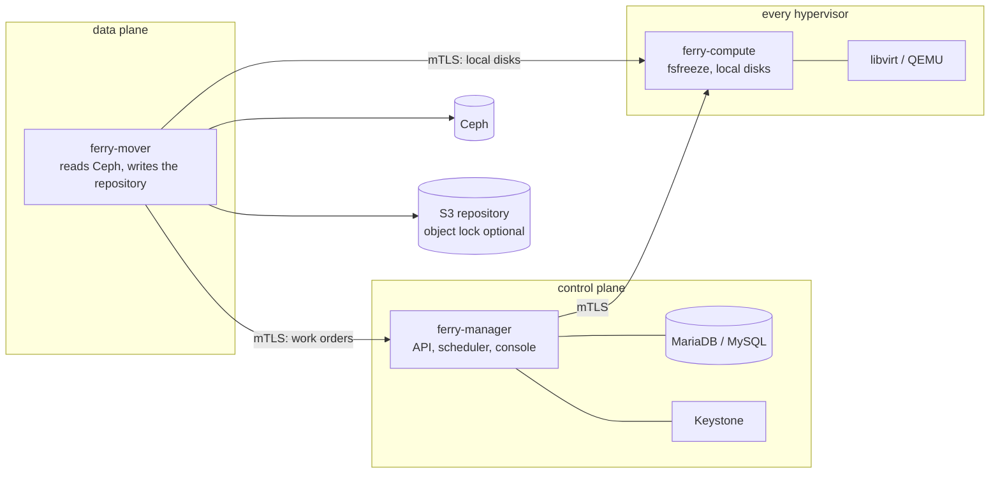

# Ferry deployment

[](https://github.com/osie/ferry-deploy/actions/workflows/ci.yml)
[](https://github.com/osie/ferry-deploy/releases)
[](LICENSE)

Deployment manifests for [Ferry](#what-ferry-is): backup, restore and disaster
recovery for OpenStack. This repository holds what an operator needs to put Ferry
on a cloud with the deployment tool that cloud already uses:

| distribution | deploy with | guide | verified on |
|---|---|---|---|
| kolla-ansible 2025.1+ | [`kolla-ansible/`](kolla-ansible) | [kolla-ansible guide](docs/kolla-ansible.md) | lab and production |
| openstack-helm | [`helm/ferry`](helm/ferry), `presets/openstack-helm.yaml` | [chart README](helm/ferry/README.md) | openstack-helm 2025.1 lab |
| Atmosphere, Genestack, StarlingX, MOSK, Yaook | [`helm/ferry`](helm/ferry), one preset each | [chart README](helm/ferry/README.md) | rendered and schema-checked in CI, not yet in a lab |
| Red Hat OpenStack Services on OpenShift 18 | [`helm/ferry`](helm/ferry), `presets/rhoso.yaml` | [chart README](helm/ferry/README.md) | RHOSO 18.0 lab |
| Charmed OpenStack, Canonical OpenStack (Sunbeam) | [`juju/`](juju) | [charms README](juju/README.md) | Charmed 2024.1 and Sunbeam 2024.1 labs |

[Where Ferry deploys](docs/deployers.md) compares them: who provides the database,
Keystone, Ceph and the hypervisor agent on each.

## What Ferry is

Ferry protects OpenStack workloads — Cinder volumes, Nova instances (including
local disks, read through the hypervisor), and object storage buckets — into an
S3-compatible repository, deduplicated and encrypted, with optional object lock so
backups cannot be erased before their date. Tenants manage it through a `backup`
service in the cloud's own Keystone catalog; operators set the policies.

It runs as three components:



The manager holds the database and the Keystone credential. The mover holds
neither: it reads production storage and writes the repository. The agent on
each hypervisor freezes guests and reads local disks; it holds no repository
credential and no encryption key.

## Quick start

Each guide covers prerequisites, credentials and upgrades. The short version:

**kolla-ansible**

```sh
cd kolla-ansible
./install.sh                                   # links the role and playbook into kolla-ansible
cp inventory/ferry-groups /etc/kolla/ferry-groups
cat etc/passwords.yml >> /etc/kolla/passwords.yml && kolla-genpwd
$EDITOR /etc/kolla/globals.yml                 # see etc/globals.yml
kolla-ansible deploy -i /etc/kolla/inventory -i /etc/kolla/ferry-groups \
  -p /usr/local/share/kolla-ansible/ansible/ferry.yml
```

**Helm** (openstack-helm and the distributions built on it, Yaook, RHOSO)

```sh
helm upgrade --install ferry helm/ferry -n openstack \
  -f helm/ferry/presets/openstack-helm.yaml \
  --set cloud.name=<this cloud>
```

The chart is also published as an OCI artifact:
`oci://ghcr.io/osie/charts/ferry`.

**Juju** (Charmed OpenStack)

```sh
juju deploy ./ferry_amd64.charm ferry \
  --config cloud-name=<cloud> \
  --config volume-pools=cinder-ceph --config image-pools=glance --config vm-pools=
juju deploy mysql-router ferry-mysql-router --channel 8.0/stable
juju integrate ferry:shared-db ferry-mysql-router:shared-db
juju integrate ferry-mysql-router:db-router mysql-innodb-cluster:db-router
juju integrate ferry:identity-credentials keystone:identity-credentials
juju integrate ferry:ceph ceph-mon:client
juju integrate ferry:ceph-mover ceph-mon:client
juju integrate ferry:ceph-restore ceph-mon:client

juju deploy ./ferry-compute_amd64.charm ferry-compute
juju integrate ferry-compute:juju-info nova-compute:juju-info
juju integrate ferry-compute:manager ferry:compute
```

`charmcraft pack` in `juju/ferry` and `juju/ferry-compute` builds the two charms.
The [charms README](juju/README.md) covers Sunbeam too.

## Requirements

- MariaDB 10.6+ or MySQL 8.0.16+, usually the cloud's own.
- A Keystone service user. Every deployer creates it.
- Ceph, where the cloud has it. Clouds without Ceph are protected through their
  hypervisors.
- An S3-compatible repository. Object lock in compliance mode makes backups
  immutable.
- A private CA for Ferry's two mTLS relationships. Every deployer creates it.

## Monitoring

[`monitoring/ferry.rules`](monitoring/ferry.rules) holds Ferry's Prometheus alert
rules, and every deployer installs them: kolla-ansible next to kolla's own
Prometheus, the chart as a `PrometheusRule`, the charm through COS. Each component
serves `/metrics` on its admin port. [`monitoring/`](monitoring) lists the alerts
and how they are tested.

## Diagnosing a problem

`ferry admin support-bundle` builds one archive with everything needed to
diagnose a problem, with credentials and tenant data left out. See
[Support bundles](docs/support-bundle.md); attach one to a bug report.

## Versions

Tags match Ferry releases. A tag pins the images it deploys: the chart's
`appVersion`, the charm's `version` default and the kolla-ansible role's
`ferry_tag` all name it. [CHANGELOG.md](CHANGELOG.md) lists what changed for
operators in each release.

## Container images

The manifests deploy these images, published at `ghcr.io/osie`:

| image | runs |
|---|---|
| `ghcr.io/osie/ferry-manager` | the manager |
| `ghcr.io/osie/ferry-mover` | the mover |
| `ghcr.io/osie/ferry-mover-flr` | the mover with file-level restore |
| `ghcr.io/osie/ferry-compute` | the hypervisor agent |

The images are built from Ferry's source, which is not part of this repository,
and they are not covered by this repository's license.

## Contributing

Issues and pull requests are welcome. Read [CONTRIBUTING.md](CONTRIBUTING.md)
first, and report security issues as [SECURITY.md](SECURITY.md) describes, not in
a public issue.

## License

The contents of this repository are licensed under the
[Apache License, Version 2.0](LICENSE).
