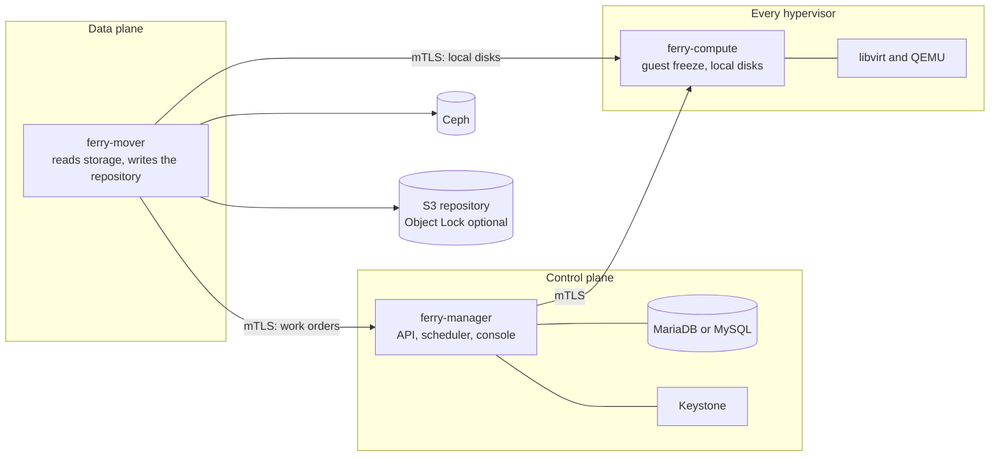

<p align="center">
  <a href="https://osie.io">
    <picture>
      <source media="(prefers-color-scheme: dark)" srcset=".github/assets/osie-logo-dark.svg">
      
    </picture>
  </a>
</p>

<h1 align="center">Ferry</h1>

<p align="center">
  <strong>Backup and disaster recovery for OpenStack</strong><br>
  Deployment manifests for kolla-ansible, Helm and Juju
</p>

<p align="center">
  <a href="https://github.com/osie/ferry-backup/actions/workflows/ci.yml"></a>
  <a href="https://github.com/osie/ferry-backup/releases"></a>
  <a href="LICENSE"></a>
  <a href="https://osie.io/docs/ferry/"></a>
</p>

<p align="center">
  <a href="https://osie.io/docs/ferry/"><strong>Documentation</strong></a>
  &nbsp;·&nbsp;
  <a href="#quick-start">Quick start</a>
  &nbsp;·&nbsp;
  <a href="docs/deployers.md">Choosing a deployer</a>
  &nbsp;·&nbsp;
  <a href="monitoring/README.md">Monitoring</a>
  &nbsp;·&nbsp;
  <a href="CHANGELOG.md">Changelog</a>
</p>

<br>

## About Ferry

Ferry is a backup and disaster recovery service for OpenStack clouds, developed by
[OSIE](https://osie.io). It protects Nova instances, Cinder volumes and object storage
buckets in S3-compatible storage, compressed, deduplicated and optionally encrypted
and immutable. It restores them in place, as new resources or in another region.

Cloud operators deploy Ferry and define its storage and protection policies. Project
members choose which resources to protect and restore them themselves, through the
console, the CLI or the API. Ferry registers as the `backup` service in the cloud's
own Keystone catalog, so it uses the identities, projects and roles the cloud already
has.

This repository holds the manifests that deploy Ferry with the tool a cloud already
uses. The product documentation is at **[osie.io/docs/ferry](https://osie.io/docs/ferry/)**.

## Capabilities

<table>
<tr>
<td width="50%" valign="top">

**[Complete instance backups](https://osie.io/docs/ferry/features/backups/)**<br>
The root disk and every attached volume, captured at the same instant, with the
flavor, networks, key pair and security groups needed to recreate the instance.
Guests can be frozen for about a second for filesystem consistency.

</td>
<td width="50%" valign="top">

**[Incremental and deduplicated](https://osie.io/docs/ferry/operate/storage-backends/)**<br>
After the first backup, only new data is stored. Ceph change tracking and qcow2
dirty bitmaps read only what changed, and deduplication uploads only data the
repository does not already hold.

</td>
</tr>
<tr>
<td valign="top">

**[Immutable backups](https://osie.io/docs/ferry/features/immutable-backups/)**<br>
S3 Object Lock in compliance mode. A backup cannot be erased before its retention
date by anyone, including an administrator or an attacker holding the cloud's
credentials.

</td>
<td valign="top">

**[Encryption](https://osie.io/docs/ferry/features/encryption/)**<br>
Per-domain data keys, sealed by a key held in Barbican or Vault, and encrypted
before anything leaves the mover.

</td>
</tr>
<tr>
<td valign="top">

**[Disaster recovery](https://osie.io/docs/ferry/features/disaster-recovery/)**<br>
Recover protection groups in another region from backups, warm standbys or
rbd-mirror copies, in boot order, with health checks. Test recovery in isolated
networks and fail back when the home region returns.

</td>
<td valign="top">

**[Flexible restores](https://osie.io/docs/ferry/features/restores/)**<br>
Restore as new resources, over the original, or
[attach a backup](https://osie.io/docs/ferry/features/file-recovery/) read-only to a
running server to recover individual files.

</td>
</tr>
<tr>
<td valign="top">

**[Ransomware signals](https://osie.io/docs/ferry/features/ransomware-signals/)**<br>
Changes in compression, entropy and new data flag suspicious backups and point to
the last recovery point taken before them.

</td>
<td valign="top">

**[Policies and self-service](https://osie.io/docs/ferry/features/protection-policies/)**<br>
Operators publish service levels with schedules, windows and retention. Projects
pick one per plan, within [vaults](https://osie.io/docs/ferry/features/vaults/),
[quotas](https://osie.io/docs/ferry/features/quotas/) and
[usage reports](https://osie.io/docs/ferry/features/usage-and-reports/) for billing.

</td>
</tr>
</table>

## Supported deployments

| Distribution | Deploy with | Verified on |
|---|---|---|
| **kolla-ansible** 2025.1 and newer | [kolla-ansible role](docs/kolla-ansible.md) | lab and production |
| **openstack-helm** | [Helm chart](helm/ferry/README.md), `openstack-helm` preset | openstack-helm 2025.1 lab |
| **Red Hat OpenStack Services on OpenShift** 18 | [Helm chart](helm/ferry/README.md), `rhoso` preset | RHOSO 18.0 lab |
| **Atmosphere, Genestack, StarlingX, MOSK, Yaook** | [Helm chart](helm/ferry/README.md), one preset each | rendered and schema-checked in CI |
| **Charmed OpenStack** and **Sunbeam** | [Juju charms](juju/README.md) | Charmed 2024.1 and Sunbeam 2024.1 labs |

[Choosing a deployer](docs/deployers.md) compares them: which component of each
distribution provides the database, Keystone, Ceph and the hypervisor agent.

## Architecture



Each component holds only what its job needs. The **manager** holds the database and
the Keystone credential. The **mover** reads production storage and writes the
repository, and holds neither. The **agent** on each hypervisor freezes guests and
reads local disks, and holds no repository credential and no encryption key. The
[architecture guide](https://osie.io/docs/ferry/operate/architecture/) covers the
details.

## Quick start

Each guide covers prerequisites, credentials, monitoring and upgrades. In short:

<details open>
<summary><strong>kolla-ansible</strong></summary>

```sh
cd kolla-ansible
./install.sh                                   # links the role and playbook into kolla-ansible
cp inventory/ferry-groups /etc/kolla/ferry-groups
cat etc/passwords.yml >> /etc/kolla/passwords.yml && kolla-genpwd
$EDITOR /etc/kolla/globals.yml                 # see etc/globals.yml
kolla-ansible deploy -i /etc/kolla/inventory -i /etc/kolla/ferry-groups \
  -p /usr/local/share/kolla-ansible/ansible/ferry.yml
```

Full guide: [docs/kolla-ansible.md](docs/kolla-ansible.md), or
[on osie.io](https://osie.io/docs/ferry/operate/install/kolla-ansible/).

</details>

<details>
<summary><strong>Helm</strong> (openstack-helm and its distributions, Yaook, RHOSO)</summary>

```sh
helm upgrade --install ferry helm/ferry -n openstack \
  -f helm/ferry/presets/openstack-helm.yaml \
  --set cloud.name=<this cloud>
```

The chart is also published as an OCI artifact at `oci://ghcr.io/osie/charts/ferry`.
Full guide: [helm/ferry/README.md](helm/ferry/README.md), or
[on osie.io](https://osie.io/docs/ferry/operate/install/helm/).

</details>

<details>
<summary><strong>Juju</strong> (Charmed OpenStack and Sunbeam)</summary>

```sh
juju deploy ./ferry_amd64.charm ferry \
  --config cloud-name=<cloud> \
  --config volume-pools=cinder-ceph --config image-pools=glance --config vm-pools=
juju deploy mysql-router ferry-mysql-router --channel 8.0/stable
juju integrate ferry:shared-db ferry-mysql-router:shared-db
juju integrate ferry-mysql-router:db-router mysql-innodb-cluster:db-router
juju integrate ferry:identity-credentials keystone:identity-credentials
juju integrate ferry:ceph ceph-mon:client
juju integrate ferry:ceph-mover ceph-mon:client
juju integrate ferry:ceph-restore ceph-mon:client

juju deploy ./ferry-compute_amd64.charm ferry-compute
juju integrate ferry-compute:juju-info nova-compute:juju-info
juju integrate ferry-compute:manager ferry:compute
```

`charmcraft pack` in `juju/ferry` and `juju/ferry-compute` builds the two charms.
Full guide: [juju/README.md](juju/README.md), or
[on osie.io](https://osie.io/docs/ferry/operate/install/juju/).

</details>

## Requirements

| Requirement | Details |
|---|---|
| **Database** | MariaDB 10.6+ or MySQL 8.0.16+, usually the cloud's own |
| **Identity** | a Keystone service user, created by every deployer |
| **Storage** | Ceph where the cloud has it; clouds without Ceph are protected through their hypervisors ([supported storage](https://osie.io/docs/ferry/operate/storage-backends/)) |
| **Repository** | S3-compatible object storage; Object Lock in compliance mode for immutable backups ([repositories](https://osie.io/docs/ferry/operate/repositories/)) |
| **PKI** | a private CA for Ferry's mTLS, created by every deployer |

## Operating Ferry

- **Monitoring.** [`monitoring/ferry.rules`](monitoring/ferry.rules) holds Ferry's
  Prometheus alert rules, and every deployer installs them. Each component serves
  `/metrics` on its admin port. See [monitoring](monitoring/README.md) and
  [metrics, alerts and logs](https://osie.io/docs/ferry/operate/metrics-alerts-logs/).
- **Diagnostics.** `ferry admin support-bundle` builds one archive for diagnosing a
  problem, with credentials and tenant data left out. See
  [support bundles](docs/support-bundle.md) and
  [troubleshooting](https://osie.io/docs/ferry/operate/troubleshooting/).
- **Upgrades.** Tags match Ferry releases, and each tag pins the images it deploys:
  the chart's `appVersion`, the charm's `version` default and the role's `ferry_tag`
  all name it. See the [changelog](CHANGELOG.md) and
  [upgrades](https://osie.io/docs/ferry/operate/upgrades/).

## Container images

| Image | Runs |
|---|---|
| `ghcr.io/osie/ferry-manager` | the manager |
| `ghcr.io/osie/ferry-mover` | the mover |
| `ghcr.io/osie/ferry-mover-flr` | the mover with file-level restore |
| `ghcr.io/osie/ferry-compute` | the hypervisor agent |

The images are built from Ferry's source, which is not part of this repository, and
they are not covered by this repository's license.

## Documentation

| Guide | Covers |
|---|---|
| [Overview](https://osie.io/docs/ferry/) | what Ferry protects and how operators and projects share the work |
| [Architecture](https://osie.io/docs/ferry/operate/architecture/) | components, credentials and network paths |
| [Installation](https://osie.io/docs/ferry/operate/install/kolla-ansible/) | kolla-ansible, Helm and Juju |
| [API reference](https://osie.io/docs/ferry/api-reference/) | the Ferry API |
| [CLI reference](https://osie.io/docs/ferry/cli-reference/) | the `openstack backup` commands |

## Contributing

Issues and pull requests are welcome. Read [CONTRIBUTING.md](CONTRIBUTING.md) first,
and report security issues privately as [SECURITY.md](SECURITY.md) describes.

## License

The contents of this repository are licensed under the
[Apache License, Version 2.0](LICENSE).

<br>

<p align="center">
  <sub>Ferry is developed by <a href="https://osie.io">OSIE</a>.</sub>
</p>
